<a id="top" name="top"></a>

<div align="center">
  <p>
    <a href="#download">下载</a> ·
    <a href="#modules">功能</a> ·
    <a href="#languages">语言</a> ·
    <a href="#architecture">架构</a> ·
    <a href="#versions">版本</a> ·
    <a href="#contact">联系</a>
  </p>

  <p>
    <a href="https://raw.gitcode.com/user-images/assets/9293520/3ba26b9a-2369-48a8-bf48-d89f6fb1575b/7月23日_填满横幅.gif"></a>
  </p>

  <h1>小思分布式人工智能平台</h1>

  <p>把散落在桌面各处的开发与运维工具，收进一个不卡顿的桌面平台。</p>

  <p>
    <a href="https://www.python.org/downloads/"></a>
    
    <a href="./LICENSE"></a>
    <a href="#languages"></a>
  </p>

  <p>
    <a href="assets/screenshots/core.png">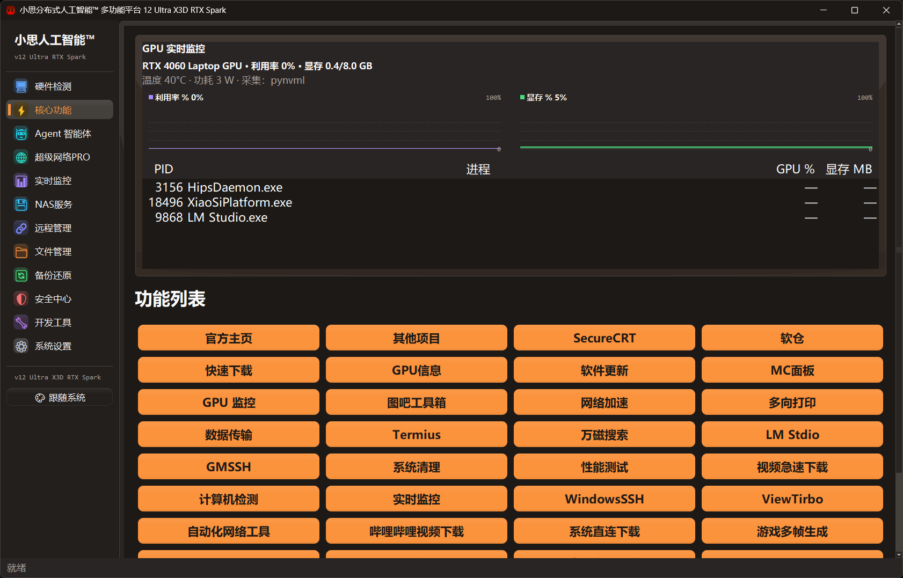</a>
  </p>
  <p>小思分布式人工智能多功能平台 12 Ultra X3D RTX Spark（第十二代），首发搭载第五代 GEN 架构。</p>
</div>

小思分布式人工智能平台是一个用 Python `tkinter` 构建的桌面平台。桌面工具箱、多线程下载器、硬件检测、系统监控，以及网络、视觉、服务与大模型管理，共用同一个窗口；检测与下载在后台线程执行，界面不会因为扫描硬件而卡住。

仓库还包含小思超级 PXE、小思超级多版本 NAS 与人工智能应用及漏洞管理。除主平台外，每个模块都有独立入口，可以单独运行，也可以组合使用。

<table>
  <tr>
    <td width="50%" valign="top">
      <a href="assets/screenshots/hardware.png">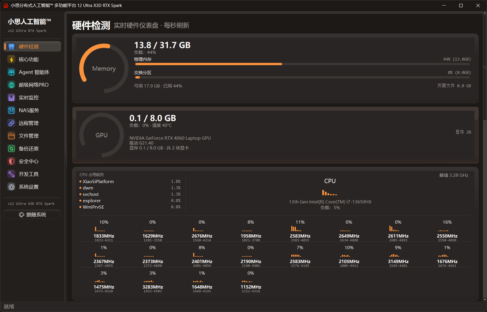</a>
      <p align="center">硬件检测：内存、GPU 与 CPU 实时仪表盘。</p>
    </td>
    <td width="50%" valign="top">
      <a href="assets/screenshots/monitor.png">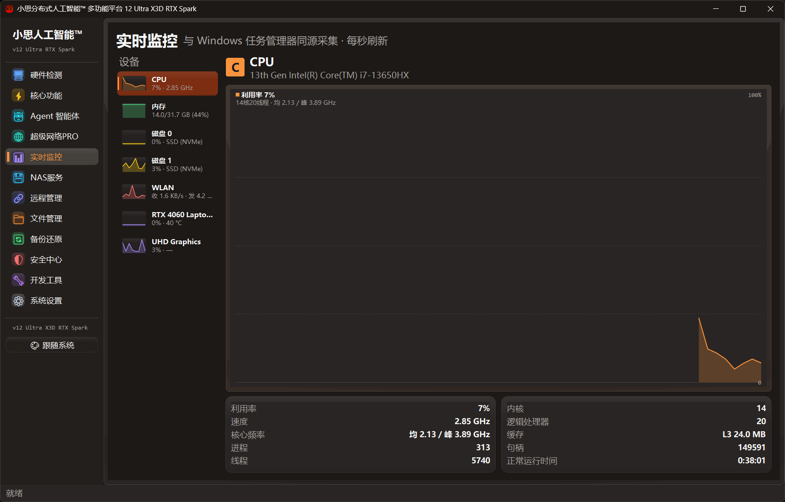</a>
      <p align="center">实时监控：与 Windows 任务管理器同源采集，每秒刷新。</p>
    </td>
  </tr>
  <tr>
    <td width="50%" valign="top">
      <a href="assets/screenshots/agent.png">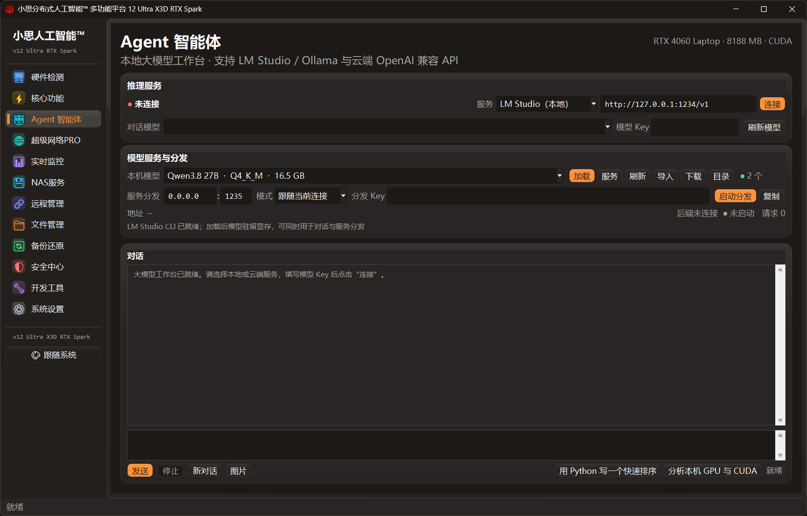</a>
      <p align="center">Agent 智能体：本地大模型工作台，支持 LM Studio / Ollama 与 OpenAI 兼容 API。</p>
    </td>
    <td width="50%" valign="top">
      <a href="assets/screenshots/network-pro.png">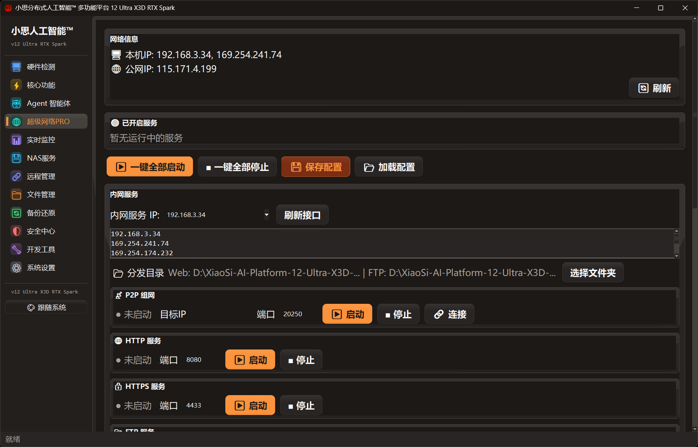</a>
      <p align="center">超级网络 PRO：网络信息与 P2P / HTTP / HTTPS 服务管理。</p>
    </td>
  </tr>
  <tr>
    <td width="50%" valign="top">
      <a href="assets/screenshots/nas.png">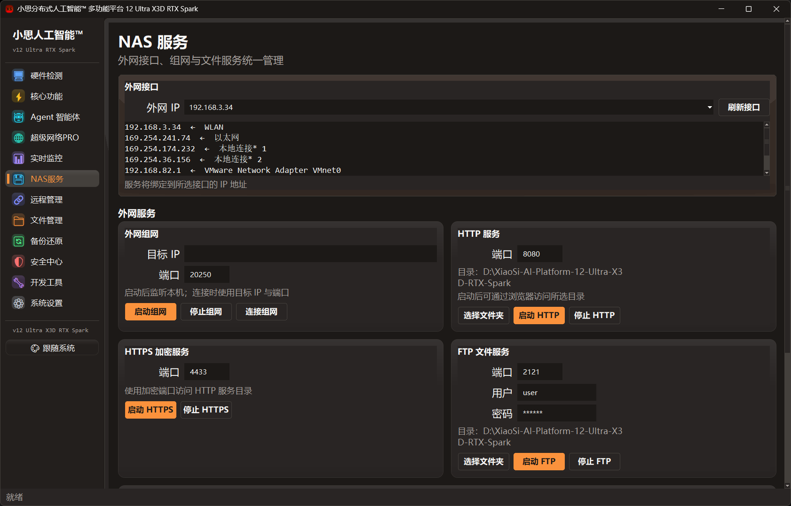</a>
      <p align="center">NAS 服务：外网接口、HTTP / HTTPS / FTP 与组网管理。</p>
    </td>
    <td width="50%" valign="top">
      <a href="assets/screenshots/files.png">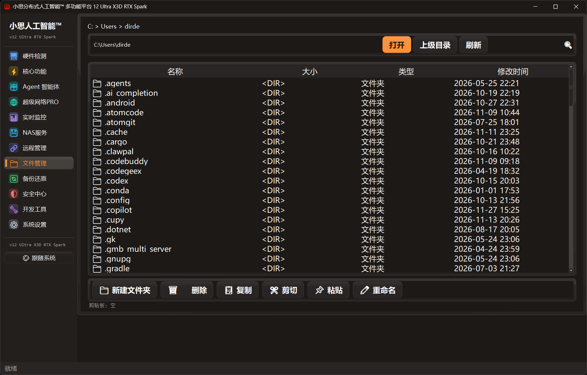</a>
      <p align="center">文件管理：本地目录浏览、复制、剪切与重命名。</p>
    </td>
  </tr>
  <tr>
    <td width="50%" valign="top">
      <a href="assets/screenshots/security.png">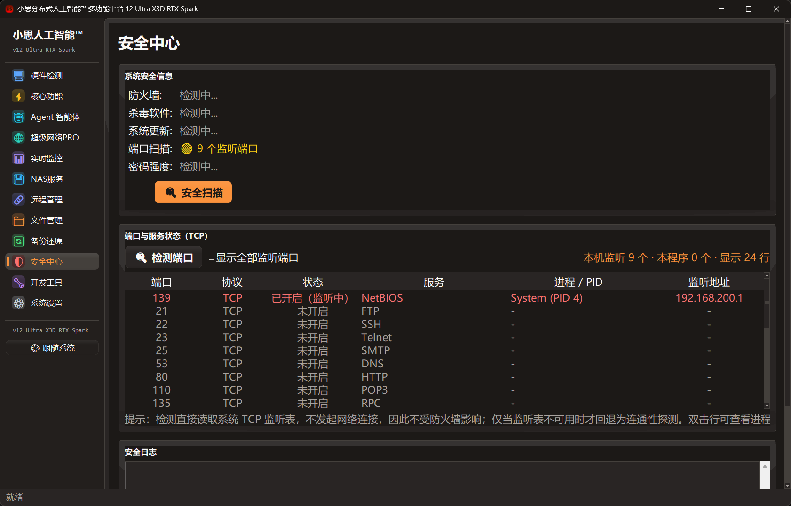</a>
      <p align="center">安全中心：系统安全信息与 TCP 监听端口扫描。</p>
    </td>
    <td width="50%" valign="top">
      <a href="assets/screenshots/dev-tools.png">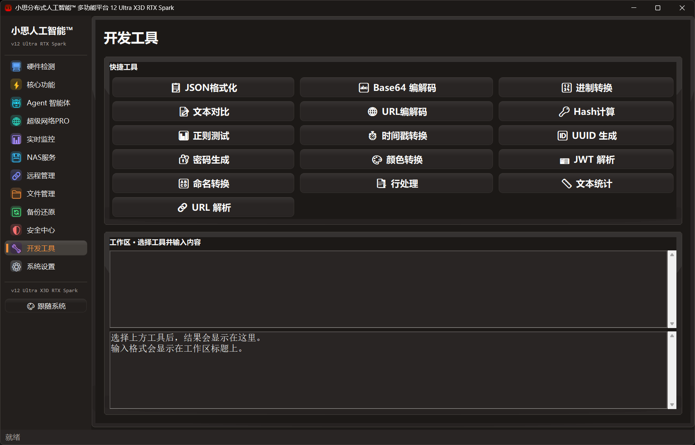</a>
      <p align="center">开发工具：JSON 格式化、Base64、Hash、正则等快捷工具。</p>
    </td>
  </tr>
  <tr>
    <td width="50%" valign="top">
      <a href="assets/screenshots/backup.png">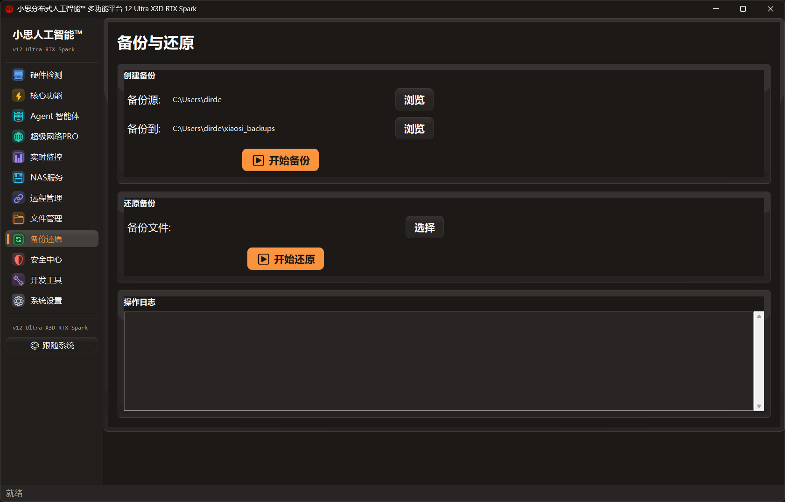</a>
      <p align="center">备份与还原：目录备份、还原与操作日志。</p>
    </td>
    <td width="50%" valign="top">
      <a href="assets/screenshots/settings.png">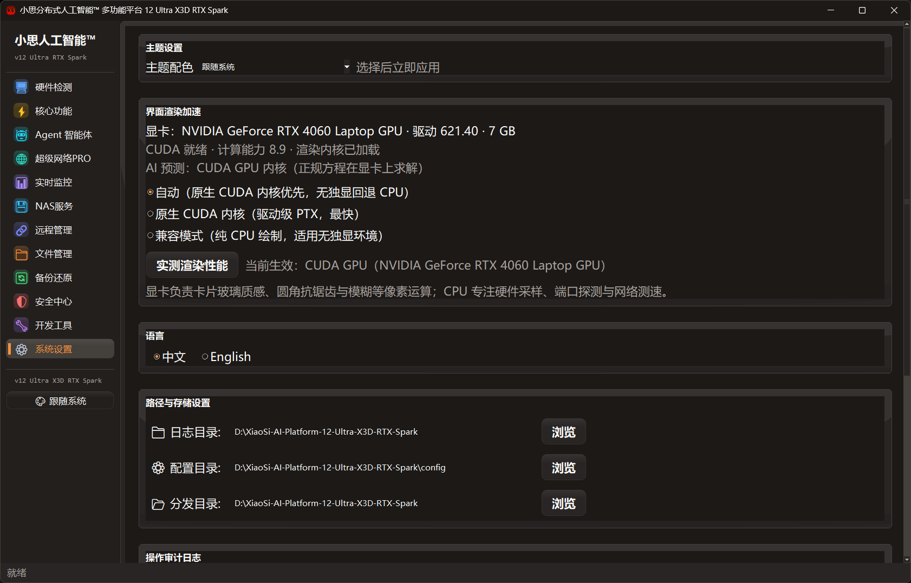</a>
      <p align="center">系统设置：主题配色、CUDA 渲染加速与语言。</p>
    </td>
  </tr>
</table>

<p align="center">点击任意截图可查看原图。</p>

## 它解决什么问题

<table>
  <tr>
    <td width="50%" valign="top">
      <p><strong>工具不再散落。</strong> 工具箱以分类网格收纳常用工具，点开即用，不必在桌面十几个图标之间来回切换。</p>
    </td>
    <td width="50%" valign="top">
      <p><strong>硬件信息不必装一堆软件。</strong> 通过 NVML / PyCUDA 直接读取 GPU 架构、显存与温度，配合系统监控查看整机状态。</p>
    </td>
  </tr>
  <tr>
    <td width="50%" valign="top">
      <p><strong>下载不再怕断。</strong> 内置多线程分块下载与断点续传，大文件可以接着下。</p>
    </td>
    <td width="50%" valign="top">
      <p><strong>本地服务一套齐。</strong> 网络、视觉、服务、大模型、PXE、NAS 模块化组织，每个模块都能单独运行，也能合用。</p>
    </td>
  </tr>
</table>

**即下即用。** 发行版是打包好的可执行文件，双击运行，不需要配置 Python 环境。**跨平台。** Windows、Linux、macOS 均可运行；源码方式下每个模块都有独立入口。**不卡界面。** 硬件检测、WiFi 扫描与下载都在后台线程执行，主窗口保持响应。

**给谁用。** 开发者、运维、技术爱好者，以及想在本地搭一套「小而全」工具链的人。

<a id="download" name="download"></a>

## 下载

| 平台 | 安装包 |
| --- | --- |
| Windows 10/11 (x86/x64)、Windows Server 2019/2022 | 发行版 `.exe`，即下即用 |
| Linux (Ubuntu/CentOS)、macOS | 源码运行，见[从源码构建](#setup) |

<p align="center">
  <a href="https://gitcode.com/dirde12078fb5/Xiaosi-Distributed-Artificial-Intelligence-Platform/releases"></a>
  <a href="https://gitcode.com/dirde12078fb5/Xiaosi-Distributed-Artificial-Intelligence-Platform/releases"></a>
</p>

发行版与历史版本见 [GitCode Releases](https://gitcode.com/dirde12078fb5/Xiaosi-Distributed-Artificial-Intelligence-Platform/releases)，也提供[夸克网盘群](https://pan.quark.cn/g/8968af6533)与[哔哩哔哩演示](https://www.bilibili.com/video/BV1zV27B8EMH)。

<p align="center">
  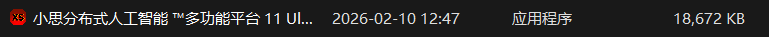
</p>
<p align="center">发行版可执行文件。项目文件较大且会持续增大，建议用 7-Zip 解压：<a href="https://7-zip.org/download.html">英文站</a> / <a href="https://sparanoid.com/lab/7z/">中文站</a>。</p>

<a id="quick-start" name="quick-start"></a>

## 快速开始

1. 从 [Releases](https://gitcode.com/dirde12078fb5/Xiaosi-Distributed-Artificial-Intelligence-Platform/releases) 或夸克网盘群下载发行版。
2. 使用 7-Zip 解压。
3. 双击可执行文件启动，无需安装 Python。
4. 在工具箱的分类网格中选择要用的模块。

从源码运行：

```bash
git clone https://gitcode.com/dirde12078fb5/Xiaosi-Distributed-Artificial-Intelligence-Platform.git
cd Xiaosi-Distributed-Artificial-Intelligence-Platform
```

依赖安装与启动方式见[从源码构建](#setup)。

<a id="modules" name="modules"></a>

## 功能

主桌面平台与各子模块都在同一个仓库里。除主平台外，每个模块都有独立入口，可以单独运行。

| 模块 | 能力 | 入口 | 依赖 |
| :-- | :-- | :-- | :-- |
| **主桌面平台（旗舰）** | 工具箱 + 多线程下载 + 硬件检测 + 系统监控 | 发行版 exe | 即下即用 |
| **网络管理 (WLAN)** | WiFi 扫描、网络工具 GUI | `小思分布式人工智能网络模块.py` | `requirements.txt` |
| **视觉管理** | 摄像头 / 图像处理 GUI | `小思分布式视觉管理模块.py` | `requirements 视觉模块.txt` |
| **服务管理** | 内网 / 外网通信服务 | `内网通服.py` / `外网通服.py` | `requirements 服务管理.txt` |
| **大模型管理** | OpenClaw + LM Studio 本地大模型 | [见下文](#llm) | Node.js / LM Studio |
| **小思超级 PXE** | 跨平台网络安装系统（DHCP / TFTP / HTTP） | `小思超级服务/小思超级PXE/gui.py` | Python 标准库，无额外依赖 |
| **小思超级多版本 NAS** | 多版本 NAS 服务（Go / 20 种语言） | `小思超级服务/小思超级多版本NAS 1/`、`小思超级服务/小思超级多版本NAS 2/` | Go 1.24+ / 各自语言工具链 |
| **人工智能应用及漏洞管理** | AI 应用与漏洞管理 | `小思人工智能应用及漏洞管理/` | 见子目录 README |

### 桌面工具箱与下载器

主桌面平台把工具箱、多线程下载、硬件检测与系统监控收进一个窗口。工具箱以分类网格呈现，点开即用；下载器支持多线程分块与断点续传。侧栏还集成 Agent 智能体、超级网络 PRO、NAS 服务、远程管理、文件管理、备份还原、安全中心、开发工具与系统设置。

### 硬件检测与系统监控

通过 NVML / PyCUDA 读取 GPU 架构、显存与温度；CPU / GPU 检测与系统监控在后台线程运行，检测过程不阻塞界面。

### 网络管理 (WLAN)

WiFi 扫描与网络工具图形界面，依赖 `requirements.txt`。

```bash
python 小思分布式人工智能网络模块.py
```

### 视觉管理

摄像头采集与图像处理图形界面，依赖 `requirements 视觉模块.txt`。

```bash
python 小思分布式视觉管理模块.py
```

### 服务管理

内网 / 外网通信服务，依赖 `requirements 服务管理.txt`。

```bash
python 内网通服.py && python 外网通服.py
```

<a id="llm" name="llm"></a>

### 大模型管理（OpenClaw + LM Studio）

在本地私密运行 **gpt-oss、Qwen3、Gemma3、DeepSeek** 等模型，由 OpenClaw 联合 LM Studio 提供。

安装 LM Studio：

```bash
# macOS / Linux
curl -fsSL https://lmstudio.ai/install.sh | bash

# Windows (PowerShell)
irm https://lmstudio.ai/install.ps1 | iex
```

安装 OpenClaw：

```bash
npm install -g openclaw@latest
openclaw onboard --install-daemon
openclaw channels login
openclaw gateway --port 18789
```

本地默认控制台：<http://127.0.0.1:18789/>

架构：

```text
WhatsApp / Telegram / Slack / Discord / Feishu / LINE / Teams / Matrix ...
               │
               ▼
        ┌─────────────┐
        │   Gateway    │  ws://127.0.0.1:18789
        └──────┬───────┘
               ├─ Pi agent (RPC)
               ├─ CLI (openclaw …)
               ├─ WebChat UI
               ├─ macOS app
               └─ iOS / Android nodes
```

若 PowerShell 提示「禁止运行脚本」，请以管理员身份执行 `Set-ExecutionPolicy RemoteSigned`（输入 `Y` 或 `A`）。

### 小思超级 PXE

纯 Python 跨平台 PXE 网络安装系统（DHCP / TFTP / HTTP），自带 GUI，仅使用标准库，无额外依赖。

```bash
cd 小思超级服务/小思超级PXE
python gui.py          # 图形界面（推荐）
# 或
python cli.py server   # 命令行（需管理员 / root）
```

详见 [小思超级 PXE 文档](./小思超级服务/小思超级PXE/README.md)。

### 小思超级多版本 NAS

第一代以 Go 实现；第二代提供 20 种语言的同构实现，统一 API、配置互通，每个版本都可独立运行。

```bash
cd "小思超级服务/小思超级多版本NAS 1"
go run cmd/server/main.go
```

详见 [第一代 NAS 文档](./小思超级服务/小思超级多版本NAS%201/README.md) 与 [第二代 NAS 文档](./小思超级服务/小思超级多版本NAS%202/README.md)。

### 人工智能应用及漏洞管理

AI 应用与漏洞管理模块，详见 `小思人工智能应用及漏洞管理/README.md`。

<a id="setup" name="setup"></a>

## 从源码构建

需要 Python 3.14 与 pip。`快速搭建/` 里的脚本会把三份 requirements 一起装好。

### 一键脚本

| 平台 | 操作 |
| --- | --- |
| Windows | 双击 `快速搭建\一键安装.bat` 安装依赖；再双击 `快速搭建\一键启动.bat`，按编号选择模块。 |
| Linux / macOS | `bash 快速搭建/install.sh` 安装依赖；`bash 快速搭建/start.sh` 启动选单。 |

### 手动安装

```bash
pip install -r "requirements.txt"             # 基础 + 网络模块
pip install -r "requirements 视觉模块.txt"     # 视觉模块
pip install -r "requirements 服务管理.txt"     # 服务管理

python 小思分布式人工智能网络模块.py          # 网络模块
python 小思分布式视觉管理模块.py              # 视觉模块
python 内网通服.py && python 外网通服.py       # 服务管理
```

<a id="languages" name="languages"></a>

## 技术栈与编程语言

主力代码是 Python 与 Go，工程脚本使用 Batch 与 Shell；`小思超级多版本NAS 2/` 用 20 种语言实现了同一套 NAS 服务，合计 22 种语言。

| # | 语言 | 分类 | 使用位置 / 用途 |
| :--: | :-- | :-- | :-- |
| 1 | **Python** | 主力开发 | 桌面平台、网络 / 视觉 / 服务管理、PXE、NAS；根目录 `*.py`、`小思超级服务/小思超级PXE/` |
| 2 | **Go** | 主力开发 | 多版本 NAS 服务端；`小思超级服务/小思超级多版本NAS 1/` |
| 3 | **Batch** | 工程脚本 | Windows 一键安装 / 启动；`快速搭建/*.bat`、`小思超级服务/**/*.bat` |
| 4 | **Shell** | 工程脚本 | Linux / macOS 一键安装 / 启动；`快速搭建/*.sh`、`小思超级服务/**/*.sh` |
| 5 | **JavaScript (Node.js)** | NAS 2 | `nodejs/`，Express 服务 |
| 6 | **TypeScript** | NAS 2 | `typescript/` |
| 7 | **Java** | NAS 2 | `java/`，Spring Boot |
| 8 | **Kotlin** | NAS 2 | `kotlin/` |
| 9 | **Scala** | NAS 2 | `scala/` |
| 10 | **C#** | NAS 2 | `csharp/`，.NET |
| 11 | **F#** | NAS 2 | `fsharp/`，.NET |
| 12 | **C++** | NAS 2 | `cpp/`，原生实现 |
| 13 | **Rust** | NAS 2 | `rust/` |
| 14 | **Swift** | NAS 2 | `swift/` |
| 15 | **Dart** | NAS 2 | `dart/` |
| 16 | **Ruby** | NAS 2 | `ruby/`，Sinatra |
| 17 | **PHP** | NAS 2 | `php/` |
| 18 | **Perl** | NAS 2 | `perl/` |
| 19 | **Lua** | NAS 2 | `lua/` |
| 20 | **Crystal** | NAS 2 | `crystal/` |
| 21 | **Nim** | NAS 2 | `nim/` |
| 22 | **Elixir** | NAS 2 | `elixir/` |

`小思超级服务/小思超级多版本NAS 2/` 提供 20 种语言的同构实现——上表第 5～22 项，加上 Python 与 Go；仓库内 `SecureCRT汉化版/` 等第三方目录附带的 VBScript / Python 示例脚本不计入统计，版权归原作者所有。

<a id="architecture" name="architecture"></a>

## GEN 架构

这里的 GEN 指第五代（Generation）平台架构，而不是代码生成器。平台分为五层：界面只负责呈现，耗时任务交给线程池，数据与外部接口各自独立，因此扫描硬件、下载大文件或轮询监控时，主窗口仍然可以操作。

### 核心组成

| 层级 | 职责 | 组成 |
| :-- | :-- | :-- |
| 用户界面层 | 窗口、标签页与状态呈现 | 主窗口 `MainApplication`，硬件检测 / 核心功能 / 下载工具 / 实时监控 / 系统设置标签页，状态栏 |
| 功能模块层 | 组织各项能力 | 硬件检测、核心功能、下载工具、实时监控、系统设置模块 |
| 线程管理层 | 调度耗时任务 | 硬件检测线程、线程池 `ThreadPool`、下载线程、监控线程 |
| 数据处理层 | 配置、日志与数据模型 | 配置管理、日志系统、硬件信息数据类 |
| 外部接口层 | 访问系统与网络 | 浏览器接口、子进程调用、文件操作、HTTP 请求 |

### 关键机制

**渲染与计算分离。** 卡片玻璃质感、圆角抗锯齿与模糊等像素运算交给 GPU；CPU 专注硬件采样、端口探测与网络测速。CUDA 可用时使用 GPU 绘制，没有独显或驱动不支持时回退到纯 CPU 兼容模式。

**模块化装配。** 侧栏把 Agent 智能体、超级网络 PRO、NAS 服务、文件管理、备份还原、安全中心、开发工具、系统设置等模块装配进同一窗口，按需切换。

**线程池调度。** 硬件检测、下载与监控分别进入后台线程；线程池负责并发任务，界面线程只接收结果。这是检测硬件时界面不卡顿的原因。

### 性能与边界

实时监控每秒刷新，下载支持多线程分块与断点续传；GPU 负责像素运算，CPU 负责采样与探测，两者按负载分工。GPU 加速需要可用的 CUDA 环境；PXE 需要管理员 / root 权限，NAS 与网络服务需要对应端口可用。

<p align="center">
  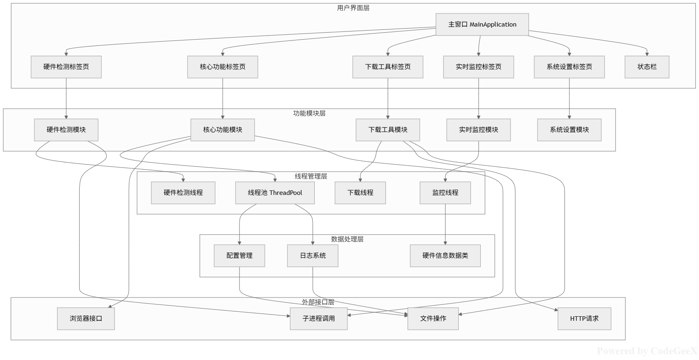
</p>
<p align="center">第 一/二/三/四 代 GEN 架构</p>

<p align="center">
  <a href="https://raw.gitcode.com/user-images/assets/9293520/2e30d969-231e-49f6-9ff6-d26ba8c37be4/架构图-120帧-功能全开.gif"></a>
</p>
<p align="center">第五代 GEN 架构</p>

<a id="versions" name="versions"></a>

## 版本

第五代 GEN 架构已应用在 4.26.4.24 及后续版本；小思超级电脑管家于 2026 年 10 月发布。

| 版本 | 系列 | 定位 | 支持平台 | 核心优点 |
| :-- | :-- | :-- | :-- | :-- |
| **基础版** | 数字系列（11 系列） | 标准版，稳定够用 | Windows 10/11 (x86/x64)、Windows Server 2019/2022 | 界面简洁、启动快、占用低、依赖少 |
| **Pro Max X3D** | ULTRA 系列 | 进阶版，跨平台 + 多线程 | 上述 + Linux (Ubuntu/CentOS)、macOS | 线程池并发、多线程下载、监控日志缓存、UI 美化 |
| **Ultra X3D** | ULTRA 系列（11 ULTRA X3D） | 旗舰版，功能最全 | 上述 + iOS | 硬件检测深度、断点续传、iOS 远程访问 |
| **NEXT** | NEXT 系列（NEXT 1 2025） | 非正式版本 | Windows 11 / Windows 11 专业版 | 安装包一体性 |

### 功能对照

| 功能 | 基础版 | Pro Max X3D | Ultra X3D | NEXT |
| :-- | :---: | :---: | :---: | :---: |
| 一站式工具箱 | ✅ | ✅ | ✅ | ✅ |
| 多线程下载 | 基础 | 线程池并发 | 断点续传 | ✅ |
| 硬件检测（CPU / GPU） | 基础 | 深度 | 深度+ | ✅ |
| 系统监控仪表盘 | ✅ | ✅ | ✅ | ✅ |
| 监控日志缓存 | — | ✅ | ✅ | ✅ |
| UI 美化 | 基础 | ✅ | ✅ | ✅ |
| 跨平台（Linux / macOS） | — | ✅ | ✅ | — |
| iOS 远程访问 | — | — | ✅ | — |
| 一体化安装包 | ✅ | ✅ | ✅ | ✅ |

选型建议：日常 Windows 使用选 **基础版**；需要跨平台 + 多线程选 **Pro Max X3D**；需要 iOS 远程 + 全功能选 **Ultra X3D**；追求一体化安装包选 **NEXT**。各版本详细发布记录与下载见 [Release 页面](https://gitcode.com/dirde12078fb5/Xiaosi-Distributed-Artificial-Intelligence-Platform/releases)。

## 安全、合规与免责

- 本平台**核心功能**（桌面工具箱、下载器、硬件检测、网络 / 视觉 / 服务 / 大模型 / PXE / NAS 等模块）均为本项目自有代码，遵循 **MIT** 许可证。
- 仓库内 `SecureCRT汉化版/`、`Windows 激活/`、`Windows 更新延迟/` 等目录下的**第三方工具版权归原作者所有**，仅作学习与便利性集成，**不参与发行版商业分发**；商业使用请购买正版。若你是权利方且要求移除，请通过下方联系方式告知，我们将即时处理。
- 使用任何激活 / 破解类工具的风险由使用者自行承担，请遵守当地法律法规。

<a id="contact" name="contact"></a>

## 社区与联系

| 渠道 | 联系方式 |
| :-- | :-- |
| 微信 | `szx20050719` |
| 邮箱 | [dirde12078904@163.com](mailto:dirde12078904@163.com) |
| 哔哩哔哩 | [BV1zV27B8EMH](https://www.bilibili.com/video/BV1zV27B8EMH) |

欢迎加入项目，让更多开源软件接入进来：

- 参与者邀请（有效期至 2027-02-01）：[点击加入](https://gitcode.com/invite/link/cdd051b1807242f69dfc)
- 开发者邀请（有效期至 2027-06-30）：[点击加入](https://gitcode.com/invite/link/d53b72e65ce9453ab9d3)

<p align="center">
  <a href="https://gitcode.com/dirde12078fb5/Xiaosi-Distributed-Artificial-Intelligence-Platform"></a>
  <a href="https://gitcode.com/dirde12078fb5/Xiaosi-Distributed-Artificial-Intelligence-Platform"></a>
  <a href="https://gitcode.com/dirde12078fb5/Xiaosi-Distributed-Artificial-Intelligence-Platform/releases"></a>
</p>

<p align="center">
  <a href="https://gitcode.com/dirde12078fb5/Xiaosi-Distributed-Artificial-Intelligence-Platform"></a>
</p>
<p align="center">Star 趋势。如果这个项目对你有帮助，欢迎点一个 Star。</p>

<a id="license" name="license"></a>

## 许可证

本项目核心功能以 [MIT 许可证](./LICENSE) 开源。

## 社会贡献及版权证书

<div align="center">
  
  

  <br/><br/>

  <p>小思分布式人工智能平台 · MIT License</p>
  <p><a href="#top">回到顶部</a></p>
</div>
